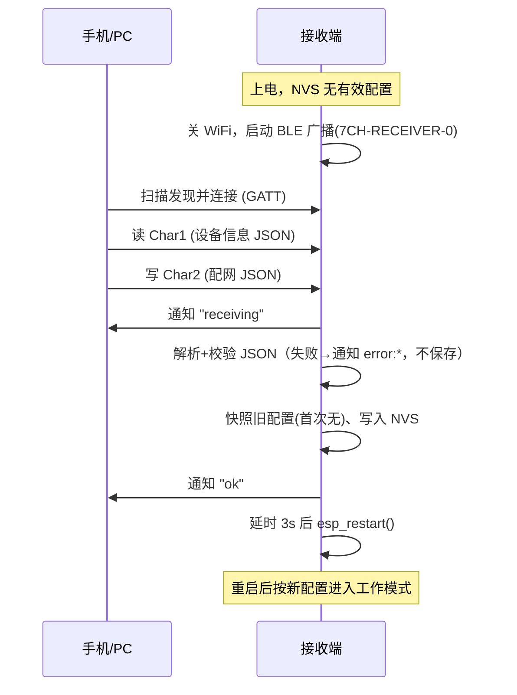
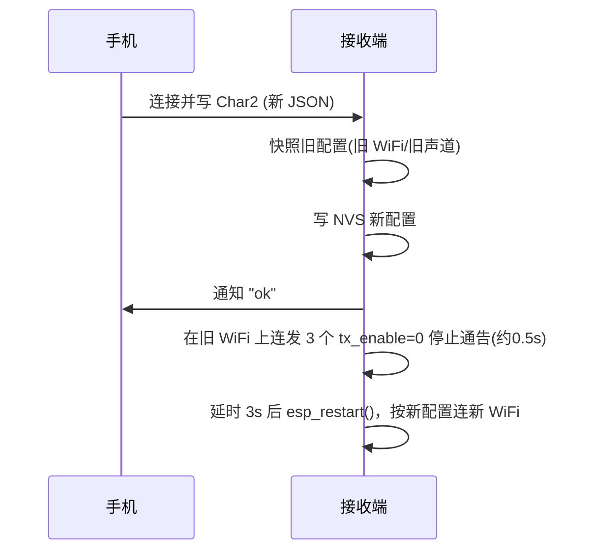
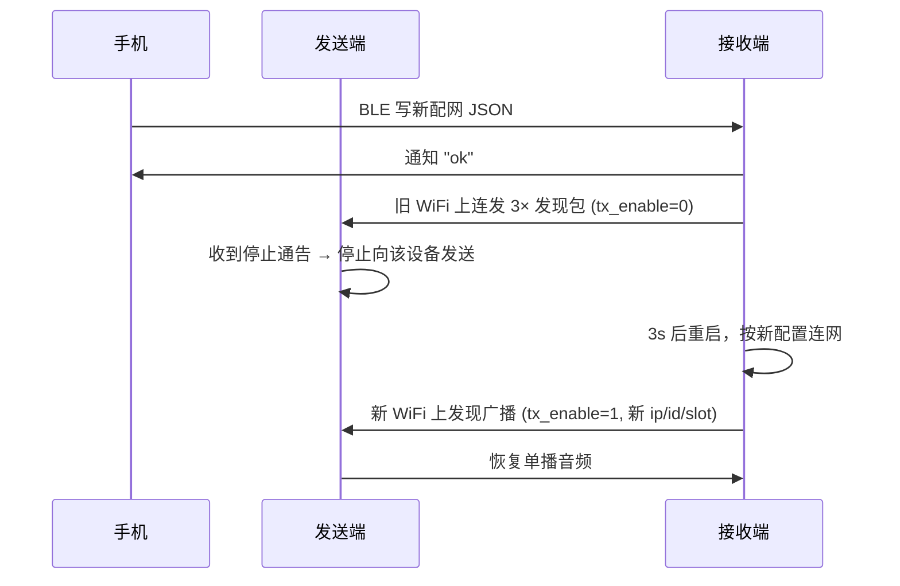
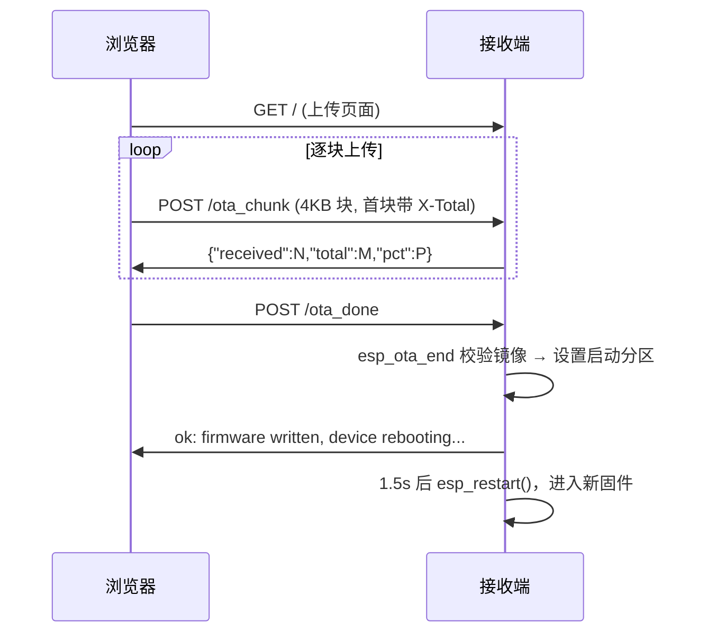

---
AIGC:
    Label: "1"
    ContentProducer: 001191440300708461136T1XGW3
    ProduceID: e64b5553ca31f0318c1e91126164a919_82255316d40e11f1a0da525400393706
    ReservedCode1: 3r/8jt5yq8irttEo2drSR1rSStqyUIfJ9eXIXZ8kpnyksSeopRzUTzAOvrFPrOAtU0qrs3SYUYiOre1IubIZnQH0YQKfxex8n47q4dzNNDJRPdiEuUPIXUnRchcIZyJM5QEUVWu0xC3qfBHGQe3QSlqvswvg9Zj2tEWBULh5JvbHbIXJQlrJsCxTzJs=
    ContentPropagator: 001191440300708461136T1XGW3
    PropagateID: e64b5553ca31f0318c1e91126164a919_82255316d40e11f1a0da525400393706
    ReservedCode2: 3r/8jt5yq8irttEo2drSR1rSStqyUIfJ9eXIXZ8kpnyksSeopRzUTzAOvrFPrOAtU0qrs3SYUYiOre1IubIZnQH0YQKfxex8n47q4dzNNDJRPdiEuUPIXUnRchcIZyJM5QEUVWu0xC3qfBHGQe3QSlqvswvg9Zj2tEWBULh5JvbHbIXJQlrJsCxTzJs=
---

# 7CH 无线多声道接收端 —— 通讯协议文档

> 适用范围：`ESP32_HIFI_HOME` 工程（ESP32-C5 接收端固件）
> 协议权威依据：`main/receiver.c`、`main/ble_provision.c`、`main/ota_update.c`（本工程代码为唯一字段权威）
> 版本：1.0（2026-10-30）

---

## 1. 协议总览

本工程是一个 **7.1 声道无线音频接收端**：接收端通过 BLE 一键配网接入 WiFi，之后由**发送端（PC/采集端）通过 UDP 单播**向其推送音频数据；接收端通过 UDP 定向广播持续发布自身发现信息，供发送端建立/维护传输；固件升级走设备内置 HTTP OTA 服务。

系统涉及 **4 类协议通道**：

| 通道 | 承载方式 | 端口 | 方向 | 用途 |
|---|---|---|---|---|
| BLE 配网 | BLE GATT (NimBLE) | 2.4GHz 广播/连接 | 手机 → 接收端 | 首次配置/随时改配置 WiFi、声道、设备 ID |
| 音频流传输 | UDP 单播 | 接收端 **5004** | 发送端 → 接收端 | 48kHz/32bit/单声道 PCM 数据 + XOR FEC |
| 发现广播 | UDP 定向广播 | 接收端 **6000** | 接收端 → 发送端 | 上报本机 IP、设备 ID、声道、发送使能 |
| OTA 升级 | HTTP (esp_http_server) | TCP **8080**（控制 8081） | 浏览器 → 接收端 | 固件分块上传、校验、重启升级 |

**关键设计决策（PROV_VERSION = 0x04 起）**：音频传输为**单播 UDP 5004**，不再使用组播 IP/端口（旧版协议见 §12 差异说明）。配网 JSON 中已取消 `mcast_ip` / `mcast_port` 字段。

**声道映射（slot_index 0~7）**：

| slot | 0 | 1 | 2 | 3 | 4 | 5 | 6 | 7 |
|---|---|---|---|---|---|---|---|---|
| 声道 | L | R | C | LFE | SL | SR | SBL | SBR |

**设备身份**：`device_id`（0~255，配网下发）标识每台接收端；`slot_index`（0~7）标识本机负责的声道。

---

## 2. 系统架构与端点

```
┌─────────────┐   BLE GATT (配网 JSON)   ┌─────────────────────────┐
│   手机/PC   │ ───────────────────────► │  7CH 接收端 (ESP32-C5)  │
└─────────────┘                          │  - BLE peripheral       │
                                         │  - WiFi STA/AP          │
┌─────────────┐   UDP 5004 单播(音频+FEC)│  - UDP 5004 接收        │
│   发送端     │ ───────────────────────► │  - UDP 6000 广播监听    │
│ (PC 采集端) │ ◄─────────────────────── │  - HTTP 8080 OTA        │
└─────────────┘   UDP 6000 定向广播(发现) └─────────────────────────┘
```

- **接收端固定监听**：UDP 5004（音频数据）、UDP 6000（发现广播请求）、TCP 8080（OTA）。
- **发送端**：先侦听 UDP 6000 定向广播获取接收端 IP / device_id / slot，再向该 IP 的 5004 端口单播音频包与 FEC 包。
- WiFi 工作模式：5GHz 优先，15s 内连不上回退 2.4GHz+5GHz 双频扫描；`WIFI_PS_NONE` 保证收包不阻塞。

---

## 3. BLE 配网协议

### 3.1 GATT 服务定义

- **服务 UUID**：`0000ff00-0000-1000-8000-00805f9b34fb`（128 位，主服务）
- 广播包携带该 128 位服务 UUID，手机可按 UUID 过滤设备。

| 特征 | UUID | 权限 | 内容 |
|---|---|---|---|
| Char1 设备信息 | `0000ff01-0000-1000-8000-00805f9b34fb` | 只读 | JSON：设备角色/固件版本/配网状态 |
| Char2 配网配置 | `0000ff02-0000-1000-8000-00805f9b34fb` | 可写（含无响应写） | JSON 配网数据，**≤512 字节** |
| Char3 配网状态 | `0000ff03-0000-1000-8000-00805f9b34fb` | 只读 + 通知 | 状态字符串，异步通知手机 |

### 3.2 Char1 设备信息（只读）

读取返回固定 JSON：

```json
{"device_role":"receiver","fw_version":"1.0.0","wifi_status":"provisioning"}
```

| 字段 | 类型 | 说明 |
|---|---|---|
| `device_role` | string | 固定 `"receiver"`（接收端角色） |
| `fw_version` | string | 固件版本，当前 `"1.0.0"` |
| `wifi_status` | string | 当前固定 `"provisioning"` |

### 3.3 Char2 配网配置（写入 JSON）

手机向 Char2 写入一个 JSON 字符串（≤512B），完整字段：

```json
{
  "mode": "sta",
  "ssid": "MyWiFi-5G",
  "password": "secret123",
  "channel": 36,
  "slot_index": 2,
  "output_mode": "single",
  "device_id": 1
}
```

| 字段 | 类型 | 必填 | 取值范围 / 缺省 | 说明 |
|---|---|---|---|---|
| `mode` | string | 是 | `"ap"` / `"sta"` | WiFi 工作模式（AP 或 STA） |
| `ssid` | string | 是 | 非空 | WiFi 名称 |
| `password` | string | 否 | 可空 | WiFi 密码 |
| `channel` | number | 否 | 缺省/0 → **36** | AP 信道（36 = 5GHz 信道） |
| `slot_index` | number | 否 | 0~7 | 本机声道序号，缺省 0 |
| `output_mode` | string | 否 | `"single"` / `"full"`，缺省 `"single"` | 输出模式 |
| `device_id` | number/string | 否 | 0~255，缺省 0 | 设备编号；兼容键名 `device_id` / `id` / `deviceId` / `ID`，兼容数字或字符串 `"1"` |

**校验规则**（全部通过才保存）：
- `mode` 必须为 `ap` 或 `sta`；`ssid` 非空；
- `slot_index` ≤ 7；`output_mode` 必须为 `single` 或 `full`；
- `device_id` 必须 0~255（超界**拒绝配网**，防止设备 ID 冲突）；
- 配置结构版本必须等于 `PROV_VERSION = 0x04`。

### 3.4 Char3 配网状态（通知/读取）

初始读取返回 `"idle"`。配网过程中通过 GATT 通知推送以下状态码：

| 状态码 | 含义 |
|---|---|
| `receiving` | 已收到写入请求，正在接收/解析配置 |
| `ok` | 配网成功（已写入 NVS，3 秒后重启进入工作模式） |
| `error:payload too long` | 写入数据长度 ≥512B 或为空 |
| `error:read fail` | 数据拷贝失败 |
| `error:invalid json` | JSON 解析失败 |
| `error:device_id must be 0-255` | 设备编号越界 |
| `error:mode ap/sta + ssid required; slot_index 0-7; output_mode single/full; device_id 0-255` | 配置校验不通过（含原因提示） |
| `error:nvs save fail` | 配置写入 NVS 失败 |

### 3.5 配网流程（首次配置）



### 3.6 工作模式改配置（二次配网）

工作模式下 BLE 服务**常驻**（ESP32-C5 的 BLE 2.4GHz 与 WiFi 5GHz 异频，可共存），手机可随时连接修改配置。修改流程：



### 3.7 BLE 广播（发现手机用）

| 项 | 值 |
|---|---|
| 广播名（Scan Response，完整名称） | `7CH-RECEIVER-<id>` 或 `7CH-RECEIVER-<id>-<SLOT>` |
| 名称示例 | `7CH-RECEIVER-1-L`（id=1, slot=0） |
| 广播数据 | 通用可发现 + 不支持传统 BR/EDR；携带 128 位服务 UUID |
| 厂商数据（AD type 0xFF，6B） | `FF FF`（公司 ID 0xFFFF，测试用）+ 本机 IPv4 4B（**网络序**；未联网时全 0） |
| 广播间隔 | 100~150ms |
| 广播模式 | 可连接 + 可发现，公共地址，持续广播 |
| IP 变化 | 停播后立即用新 IP 重新组包广播 |
| 广播失败 | 指数退避重试 1s/2s/4s…封顶 10s，连续 8 次失败重启重新进入配网 |

> 手机**无需连接**即可从广播厂商数据直接读到接收端当前 WiFi IP。

---

## 4. 音频流传输协议（UDP 5004）

### 4.1 传输方式

- 协议：**UDP 单播**（发送端 → 接收端 IP 的 5004 端口）。
- 发送端依据发现广播（§6）获取目标 IP；接收端固定监听 5004。
- 音频参数：**48kHz、32bit 单声道 PCM**，每包 48 帧（约 1ms 音频）。

### 4.2 RTP 固定头（12 字节，网络字节序）

所有音频包、FEC 包、发现包共用该 12B 头：

| 偏移 | 大小 | 字段 | 说明 |
|---|---|---|---|
| 0 | 1B | `v_p_x_cc` | 固定 `0x80`（v=2, p=0, x=0, cc=0） |
| 1 | 1B | `pt` | **96**=音频数据 / **97**=FEC / **98**=发现广播 |
| 2-3 | 2B | `seq` | 包序号，网络序，发送端单调递增（uint16，见回绕规则） |
| 4-7 | 4B | `ts` | 时间戳，网络序；本工程音频包不参与同步（保留字段），发现包填充开机毫秒 |
| 8-11 | 4B | `ssrc` | 固定 `0x7C41`（网络序），接收端以此过滤非法来源 |

### 4.3 音频数据包格式（总长 204B）

```
┌──────────────────────────── 204 Bytes ────────────────────────────┐
│ RTP Header 12B (pt=96, ssrc=0x7C41) │  载荷 192B (48帧×32bit)   │
└───────────────────────────────────────────────────────────────────┘
```

| 段 | 长度 | 内容 |
|---|---|---|
| RTP 头 | 12B | `v_p_x_cc=0x80`、`pt=96`、`seq` 网络序、`ts` 网络序、`ssrc=0x7C41` |
| 载荷 | **192B** | 48 帧 × 4B（32bit 单声道 PCM，小端） |

**接收端校验**：只接受 `ssrc == 0x7C41` 且**总长恰好 204B** 的 UDP 数据报；不符直接丢弃。

### 4.4 序号回绕（uint16）

`seq` 为 uint16，所有窗口/差值比较均用 `(int16_t)` 强转后的有符号差（代码 `seq_diff` / `seq_gt` / `seq_lt` / `seq_dist`），保证 65535→0 回绕时判定正确。

---

## 5. FEC 前向纠错协议（XOR）

### 5.1 编码规则（发送端）

- **每 10 个音频数据包**生成 1 个 FEC 包；FEC 包载荷 = 该组 10 包载荷逐字节 XOR。
- FEC 包 `pt=97`，载荷长度同样 192B；RTP 头中 `ssrc=0x7C41`。
- **FEC 包 seq = 该组首个数据包 seq − 1**（uint16 无符号减法）：

| 数据组 | 数据包 seq | FEC 包 seq |
|---|---|---|
| 首组（发送端 `g_seq` 从 9 起步） | 10..19 | **9** |
| 第 0 组概念示例 | 0..9 | **65535**（9−10 回绕） |

> ⚠️ **回绕语义**：首组 FEC 包 `seq=65535` 保护数据包 `0..9`。所有 seq 比较须按 uint16 回绕理解，勿误判为保护窗口错误。

### 5.2 保护窗口（接收端）

- FEC 包 seq 为 `F`，则其保护窗口为 `[F+1, F+10]`（含两端，按 uint16 回绕取模）。
- 接收端维护 FEC 组状态：记录窗口内收到的包序号集合与 XOR 累计值。

### 5.3 恢复规则

| 窗口内缺失数 | 行为 |
|---|---|
| 缺 1 包 | 用 XOR 累计值 ⊕ 已收包恢复缺失包，送入播放 |
| 缺 ≥2 包 | 无法恢复，静音填充该组缺口并推进播放 |
| 0 缺失（完整组） | 冗余 FEC 包直接丢弃 |

### 5.4 时序处理

- **FEC 组内缺口**：静音填充缺口后继续播放。
- **落后最新包超过 FEC_N（10 包）**：静音推进直到追上最新包。
- **seq 跳回 >2000**：判定发送端重启，清空 FEC/播放缓存，以新 seq 重新锚定。

---

## 6. 发现广播协议（UDP 6000）

### 6.1 传输方式

- 接收端向 **UDP 6000** 端口发送**定向广播**：目的地址 = `本机IP | (~netmask)`；掩码无效时回退 `255.255.255.255`。
- 发送端只需在 6000 端口侦听 UDP 广播即可收到所有接收端的发现包。

### 6.2 发现包格式（21B）

```
┌──── 12B RTP 头 (pt=98) ────┬── id 1B ──┬─ slot_bit 1B ─┬─ tx_enable 1B ─┬── ip 4B ──┬─ CRC16 2B ─┐
```

| 偏移 | 大小 | 字段 | 说明 |
|---|---|---|---|
| 0-11 | 12B | RTP 头 | `v_p_x_cc=0x80`、**`pt=98`**、`seq` 网络序（递增）、`ts` 网络序（开机毫秒）、`ssrc=0x7C41` |
| 12 | 1B | `id` | 设备编号（配网 `device_id`，0~255） |
| 13 | 1B | `slot_bit` | 声道位图：`1 << slot_index`（如 slot=2 → `0x04`） |
| 14 | 1B | `tx_enable` | **1**=正在/即将正常发送，**0**=即将停止发送（配置变更通告） |
| 15-18 | 4B | `ip` | 本机 IPv4，**网络序** |
| 19-20 | 2B | `crc16` | CRC16-CCITT-FALSE 校验值，**小端**存放 |

**CRC 计算**：对**前 19 字节**计算，算法 CRC-16/CCITT-FALSE（init=`0xFFFF`，poly=`0x1021`），结果低字节在前、高字节在后（小端）。

### 6.3 发送周期与触发

| 场景 | 行为 |
|---|---|
| 无音频流（最近 3s 未收到音频包） | 每 **5s** 广播 1 包 |
| 有音频流 | 每 **20s** 广播 1 包 |
| 首次上线 / IP 变化 | **连发 3 包**，包间隔 200ms |
| 配网配置变更（重启前） | 在**旧 WiFi** 上连发 3 个 `tx_enable=0` 的"停止发送"通告，再延时重启 |

### 6.4 停止通告语义（关键交互）

发送端收到 `tx_enable=0` 的发现包后，应停止向该接收端发送音频流。该机制用于配置变更场景：接收端即将离线切换 WiFi，先告知发送端停止发送，避免音频断流误判与无效发送。

---

## 7. OTA 升级协议（HTTP 8080）

### 7.1 服务信息

- 工作模式下启动 HTTP 服务，监听 **TCP 8080**（控制端口 8081 错开）。
- 分区要求：`nvs / otadata / phy_init / ota_0 / ota_1`（8MB flash），需双 app 分区。
- 固件大小前端限制：**100,000 ~ 4,000,000 字节**。

### 7.2 端点定义

| 方法 | 路径 | 用途 | 请求 | 成功响应 |
|---|---|---|---|---|
| GET | `/` | 上传页面（HTML） | — | `text/html` 页面（含分块上传 JS） |
| POST | `/ota_chunk` | 分块写入固件 | 4KB 二进制块；**首块必须带 `X-Total` 头**（固件总字节数）；可带 `X-Offset`（偏移，仅参考） | `{"received":<int>,"total":<int>,"pct":<int>}` |
| POST | `/ota_done` | 校验并切换启动分区 | — | `ok: firmware written, device rebooting...`，1.5s 后重启 |
| POST | `/ota_abort` | 放弃本次升级 | — | `ok: aborted, can retry` |

**分块协议**：浏览器把固件切成 4KB 块逐块 POST `/ota_chunk`，服务端每写一块返回进度 JSON（`received` 累计已写入字节数 / `total` 总字节数 / `pct` 百分比）。客户端以 `received` 作为下一块起点（块间串行、顺序写入）。首块初始化 OTA 会话（校验 `X-Total`、分区容量）。

### 7.3 错误码（HTTP 状态 + 文本）

| 状态码 | 文本 | 触发条件 |
|---|---|---|
| 400 | `missing X-Total header` | 会话未激活且首块缺总长度 |
| 500 | `no OTA partition` | 分区表无 ota_0/ota_1 |
| 400 | `firmware too large` | 总字节数大于 OTA 分区容量 |
| 500 | `ota begin failed` | `esp_ota_begin` 失败 |
| 400 | `chunk too large` | 单块 >4KB |
| 500 | `upload interrupted` | 连接中断（写入中止，原固件不受影响） |
| 500 | `flash write failed` | `esp_ota_write` 失败 |
| 400 | `image validation failed (wrong file?)` | `esp_ota_end` 镜像校验失败（magic/校验和） |
| 500 | `set boot partition failed` | 设置启动分区失败 |
| 400 | `no OTA session` | 未开始会话即调用 `/ota_done` |

**安全特性**：任何失败路径调用 `esp_ota_abort`，运行分区不受影响，设备继续跑旧固件；只有 `esp_ota_end` 校验通过的镜像才切换启动分区。

---

## 8. 错误处理与健壮性汇总

| 层 | 机制 | 行为 |
|---|---|---|
| BLE | 状态通知 error 码 | 手机可实时看到失败原因，允许重写 |
| BLE | 广播失败退避 | 1s→10s 指数退避，8 次失败重启 |
| 音频 | SSRC/长度过滤 | 丢弃非 `0x7C41`、非 204B 报文 |
| 音频 | FEC 恢复 | 缺 1 包 XOR 恢复；缺 ≥2 静音；完整组冗余丢弃 |
| 音频 | 落后/重启检测 | 落后 >10 包静音推进；seq 回跳 >2000 清缓存重锚 |
| 发现 | 周期+连发 | 无流 5s/有流 20s 保活；IP 变化连发 3 包防丢 |
| 配网 | 停止通告 | 配置变更前发 `tx_enable=0`，发送端及时停发 |
| OTA | 分块+校验+回滚 | 校验失败即中止，原分区不受影响 |

---

## 9. 端到端时序示例

### 9.1 音频流建立（发送端发现接收端）

```mermaid
sequenceDiagram
    participant S as 发送端
    participant R as 接收端
    R->>S: UDP 6000 定向广播(发现包: id/slot_bit/tx_enable=1/ip/CRC)
    S->>S: 解析发现包，校验 CRC16，记录接收端 IP+声道
    loop 持续传输
        S->>R: UDP 5004 音频包 (pt=96, 204B)
        S->>R: UDP 5004 FEC 包 (每10包1个, pt=97)
        R-->>S: (单向传输, 无 ACK; 可靠性依赖 FEC)
    end
    R->>S: 周期发现广播(有流时 20s/包)
```

### 9.2 配置变更（改声道/WiFi/ID）



### 9.3 OTA 升级



---

## 10. 示例报文

### 10.1 BLE 配网 JSON（手机 → Char2）

```json
{"mode":"sta","ssid":"MyWiFi-5G","password":"secret123","channel":36,"slot_index":2,"output_mode":"single","device_id":1}
```

### 10.2 设备信息响应（Char1 读取）

```json
{"device_role":"receiver","fw_version":"1.0.0","wifi_status":"provisioning"}
```

### 10.3 音频数据包（204B，UDP 5004 单播）

以 seq=0x0100、ts=0x00123456 为例：

```
80 60 01 00 00 12 34 56 00 00 7C 41      ← RTP 头 12B (pt=96)
00 00 00 00 00 00 00 00 00 00 00 00 ...  ← 载荷 192B = 48帧 × 4B (32bit 小端 PCM)
```

- 载荷长度为 **192B**，每帧 4 字节、小端存放；此例后续 176B 省略。
- 接收端校验：`ssrc == 0x7C41` 且总长 `== 204`。

### 10.4 FEC 包（192B 载荷，UDP 5004）

FEC 包 seq = 保护组首包 seq − 1。示例：保护数据包 seq=0x0100..0x0109 的 FEC 包：

```
80 61 00 FF 00 12 34 56 00 00 7C 41      ← RTP 头 12B (pt=97, seq=0x00FF)
XX XX XX XX ...                           ← 载荷 192B = 10 包载荷逐字节 XOR
```

### 10.5 发现包（21B，UDP 6000 定向广播）

示例参数：`id=1, slot_index=2(C) → slot_bit=0x04, tx_enable=1, ip=192.168.1.100, seq=0x000A, ts=0x00012345`：

```
80 62 00 0A 00 01 23 45 00 00 7C 41      ← RTP 头 (pt=98)
01                                        ← id = 1
04                                        ← slot_bit = 1<<2
01                                        ← tx_enable = 1
C0 A8 01 64                               ← ip = 192.168.1.100 (网络序)
D9 C7                                     ← CRC16-CCITT-FALSE(前19B) = 0xC7D9，小端存放
```

### 10.6 停止通告发现包（tx_enable=0）

示例参数：`id=2, slot_index=5(SR) → slot_bit=0x20, tx_enable=0, ip=192.168.1.101, seq=0x001E`：

```
80 62 00 1E 00 00 12 34 00 00 7C 41      ← RTP 头 (pt=98)
02                                        ← id = 2
20                                        ← slot_bit = 1<<5
00                                        ← tx_enable = 0 (即将停止发送)
C0 A8 01 65                               ← ip = 192.168.1.101 (网络序)
CD 98                                     ← CRC16-CCITT-FALSE(前19B) = 0x98CD，小端存放
```

### 10.7 OTA 请求/响应

```
POST /ota_chunk HTTP/1.1
X-Total: 1048576
X-Offset: 0
Content-Length: 4096
<4096 字节固件块>

HTTP/1.1 200 OK
Content-Type: application/json
{"received":4096,"total":1048576,"pct":0}

POST /ota_done HTTP/1.1
→ ok: firmware written, device rebooting...
```

---

## 11. CRC16 校验实现参考

发现包 CRC 采用 CRC-16/CCITT-FALSE（接收端实现）：

| 参数 | 值 |
|---|---|
| 初始值 | `0xFFFF` |
| 多项式 | `0x1021`（CCITT-FALSE，无输入/输出反转） |
| 计算范围 | 发现包前 19 字节（RTP 头 + id + slot_bit + tx_enable + ip） |
| 存放 | 低字节在前（小端） |

---

## 12. 与旧版发送端协议的差异（重要）

> ⚠️ 同仓存在**旧版发送端工程** `ESP32_HIFI_SENDER`（`main/sender.c`、`protocol.h`），其协议与**本工程接收端不兼容**，**严禁按旧版字段尺寸套用**。两者差异：

| 项 | 本工程（ESP32_HIFI_HOME，权威） | 旧版发送端（ESP32_HIFI_SENDER） |
|---|---|---|
| 音频位深 | 32bit | 24bit |
| 声道数 | 单声道（每设备 1 个 slot） | 8 声道 |
| 每包载荷 | 192B（48 帧 × 4B） | 1152B |
| 传输方式 | UDP 单播 5004 | UDP 组播 |
| 协议版本 | PROV_VERSION=0x04（取消 mcast_ip/port） | 旧版（含组播配置字段） |

本工程文档所有字段定义、载荷尺寸、端口均以 `receiver.c / ble_provision.c / ota_update.c` 为唯一权威来源；如需对接发送端，请按本文档 §4~§6 实现。

---

## 13. 附录：常量速查

| 常量 | 值 | 来源 |
|---|---|---|
| 音频端口 | UDP 5004 | receiver.c |
| 发现广播端口 | UDP 6000 | receiver.c |
| OTA HTTP 端口 | TCP 8080 / ctrl 8081 | ota_update.c |
| OTA 分块大小 | 4096 B | ota_update.c |
| OTA 重启延时 | 1500 ms | ota_update.c |
| 配网重启延时 | 3000 ms | ble_provision.c |
| PROV_VERSION | 0x04 | ble_provision.h |
| 配网 JSON 最大长度 | 512 B | ble_provision.c |
| 默认 AP 信道 | 36（5GHz） | ble_provision.c |
| 广播名基础 | `7CH-RECEIVER` | ble_provision.c |
| 声道名表 | L/R/C/LFE/SL/SR/SBL/SBR | ble_provision.c |
| 音频参数 | 48kHz / 32bit / 单声道 / 48帧每包 | receiver.c |
| FEC 组大小 | 10 数据包 + 1 XOR 包 | receiver.c |
| SSRC | 0x7C41 | receiver.c |
| PT 值 | 96 音频 / 97 FEC / 98 发现 | receiver.c |
| 发现广播周期 | 无流 5s / 有流 20s | receiver.c |
| IP 变化连发 | 3 包 × 200ms | receiver.c |
| 有流判定 | 最近 3s 内收到音频包 | receiver.c |
| 发送端重启判定 | seq 回跳 >2000 | receiver.c |
| CRC | CRC-16/CCITT-FALSE (0xFFFF/0x1021)，前 19B，小端 | receiver.c |
*（内容由AI生成，仅供参考）*
